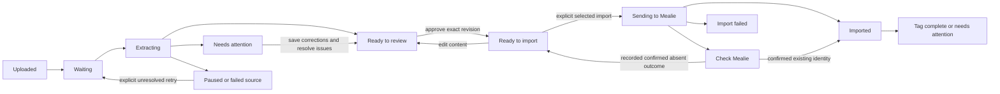

# Recipe-Importer product experience

Date: 2026-10-14. **Status: proposed design awaiting approval; no implementation authorized by this document.** Current facts and their evidence are in [the audit](UI_UX_Audit.md). [The roadmap](UI_Redesign_Roadmap.md) is the implementation handoff; [wireframes](wireframes/ui-redesign/README.md) specify placement and interactions.

## Product vision and decisions

Make a scanned cookbook become a dependable personal recipe collection, one clear decision at a time. The central activity is comparing source evidence with editable recipe text. Progress should reward careful completion, not encourage rushing unresolved quantities into Mealie.

The primary operator is the existing single local Windows user. First-time use starts with adding sources; repeat use resumes the last durable batch and recipe. Hundreds of recipes demand low repetition and dependable recovery. Multi-user remote hosting, automatic recipe generation, live collaborative editing, automatic semantic deduplication, attachment upload and a general ETL framework are excluded.

Designer calls, proposed for approval: retain three top destinations; use two main review panes and a queue drawer; use compact plain-text ingredient rows and readable step blocks, with section-level bulk editing; save committed edits automatically but expose an explicit save; put import after the review checkpoint and upload after import. These are recommendations, not user-approved choices yet.

## Experience goals and evidence trace

| Goal / proposed measure | Basis | Design choice | Acceptance owner |
| --- | --- | --- | --- |
| Fried Rice: correct one quantity and approve in no more than 3 deliberate actions after selection, excluding typing/source inspection | Repeated review is the user's highest priority | Direct fields, automatic durable save on commit, Approve & next | Luna R2; user walkthrough R6 |
| Remove 15 OCR artifact lines with one bulk-edit session and one Apply; no row-by-row deletion required | Caramel Apples scenario; A03 | Bulk editing by section with explicit structural preview | Luna R2 |
| Every blocking issue is reachable from the recipe header in one action | A04: off-pane findings, missing nonindexed proposals | Issue summary opens Issues; field-local markers where mapped | Luna R2 |
| A return after refresh restores the latest confirmed saved content and selected identity | A06 and durable history requirement | Committed-field saves, guarded navigation, persistent resume pointer | Luna R1/R2 |
| No approved, imported or uncertain recipe is recreated by a routine rerun | User invariants; A01/A05/A08 | Revision-bound consent, protected states, source/recipe separation | Luna R1/R3/R5 |
| At 1440×900, both pane headers and meaningful source/editor content appear in the first viewport | A04; user desktop target | 150–200px total application chrome target | Browser R2; not measured yet |
| At 1,000 fixture recipes, switching candidates has p95 ≤1s on the user's test machine after warm load | A11 | One active editor, bounded queue, cached previews/projections | R6 measurement; revise target explicitly if hardware cannot meet it |

These are proposed test targets, not analytics claims or model accuracy measures. Record actions, elapsed time, misclicks and lost-work events with synthetic tasks. No external telemetry is needed; optional local timings exclude recipe text and credentials.

## Journey map

| Stage | Operator objective / information / decision | Automatic handling | Failure and recovery / next action | On screen vs Details |
| --- | --- | --- | --- | --- |
| Acquire | Collect legible scans; understand accepted types | Keep originals; no moving/deleting | Unsupported/cropped file: explain replacement option | File types and example; scanning tips secondary |
| Upload | Add one recipe or a cookbook; choose batch name | Stage accepted sources durably, compute digest, preserve original filename | Partial upload resumes accepted files; invalid file remains actionable | Previews, filename/page count, per-file result; paths/hashes secondary |
| Organize | Give this batch a recognizable name and optional import tag | Reuse last safe local choices, never retag history | Duplicate bytes link to prior work rather than silently dropping | Batch name/tag distinction; tag explanation secondary |
| Extract | Decide local-only vs Gemini processing | Use configured model route and workers; no surprise cloud call | Missing OCR dependency/config: explain capability and alternate route | Mode, privacy disclosure, Start; model IDs/limits secondary |
| Monitor | Know whether work is moving and what can be reviewed now | Persist job/source progress, yield reviewed recipes early | Quota pause keeps progress; restart resumes unresolved work | Files processed and recipes available separately; route diagnostics secondary |
| Review | Compare recipe text with source | Restore page and saved draft, keep identity | Unavailable source does not erase edits; relink hash-verified source | Source/editor/issues; provenance secondary |
| Correct | Repair OCR and resolve evidence concerns | Save committed edits; preserve raw source | Write failure retains buffer and blocks leaving; conflicting revision compares versions | Local issue and saved state; original extraction under Details |
| Approve | Explicitly endorse the exact complete recipe | Save/readback, validate, record revision-bound consent | Unresolved critical issue: explain field and next action | One Approve & next; no bulk auto-approval |
| Import | Choose approved recipes/tag and send once | Recheck revision/protection, record each outcome, preserve tags | Definite rejection permits scoped retry; uncertain result requires checking | Selected count, tag, exclusions; HTTP diagnostics secondary |
| Verify | Confirm created recipe and outstanding tag work | Show slug/link and independent create/tag outcome | Tag failed: retry tag only; uncertain: reconcile | Result rows and next action; event trail secondary |
| Maintain | Resume, find problems, inspect prior decisions | Preserve history and earlier extractions | Ambiguous split/rename never creates duplicate automatically | Needs attention and history; explicit retag/re-extraction controls secondary |

## Information architecture

Use native top navigation: **Uploads · Review · Import & history**. The destination is Uploads for a fresh installation with no sources; Review for unresolved extracted recipes; otherwise resume last valid destination. Never change destination because a background counter updates. Keep Help/Settings in a secondary menu; credentials remain environment-owned, not a prominent settings form.

Each destination has one compact batch selector shared across pages. Display human batch name, not source hash. Before batch manifests exist, use **Existing library** and **Source** filtering by filename; do not call a file hash a batch. Batch is a local grouping; **Mealie tag** is an optional import instruction. Explain that the tag can support a Mealie cookbook filter; naming a local batch does not create a Mealie cookbook.

Objects are distinct: batch → sources → extracted candidates → edit revisions → decisions → import outcomes. A source may produce zero, one or many candidates. Import history remains accessible if the extraction cache is missing. Source retry status does not overwrite an imported sibling's recipe status.

Queue presets: **To review**, **Needs attention**, **Ready to import**, **All recipes**. Protected recipes are inspectable via All recipes/history but never editable. Source-level failures without candidates live in Uploads activity and an attention summary linking there. A filtered empty queue is not “all done”.

## Major pattern decisions

| Decision | Alternative A | Alternative B | Recommendation / tradeoff / revisit trigger |
| --- | --- | --- | --- |
| Navigation | Three task destinations | Linear wizard / stepper | Three destinations: users resume and interleave batches. Wizard would force backtracking; use an inline first-run checklist only. Native navigation makes keyboard semantics straightforward. |
| Recipe selection | Permanent 240px queue rail | Compact title/position with Queue drawer | Drawer by default at 1440px preserves source/editor space. Large searchable queue shown on demand, one active editor. Optional pin only if later observation supports it, not first release. |
| Source/editor | Three permanent columns | Two panes; queue off workspace | Two panes (~45/55) at wide widths; no persistent third issue pane. Fewer cramped fields. Native columns feasible; zoom/position needs browser spike. |
| Editing | Per-row controls everywhere | Plain editable rows + row menu + section bulk edit | Hybrid: precise editing for small fixes, bulk for OCR. Not a spreadsheet: instructions wrap and ingredients retain original wording. Row menus reduce tab stops. |
| Instruction correction | Single giant text area | Ordered step blocks with section bulk editor | Step blocks default; Bulk handles fragments. Apply shows resulting step count and change preview. Never infer steps from punctuation automatically. |
| Suggestions | Separate global proposal page | Field-local card plus complete Issues view | Local card minimizes context switching; Issues catches unlocated/multiple suggestions. No colored text inserted into source transcription. |
| Actions | Toolbar above long page only | Persistent compact review action strip | Persistent strip desired, with native top/bottom duplication as feasibility fallback. Only Approve & next primary; Save, Skip and Previous secondary. Sticky behavior must not obscure focus. |
| Progress | Dashboard cards / percent recipes done | Compact counts + source processing progress + next action | Counts and next action; total recipes unknown until extraction ends. File denominator only when known. No speculative ETA or falsely linear recipe percentage. |
| Upload | Choose all technical routing options | Name batch, optional tag, three clearly explained processing modes | Simple first-run defaults from config; advanced model/quota controls disclosed. Mode accurately names network effects. |

Streamlit remains the platform. Native `st.navigation`, `st.container(horizontal=True, wrap=True)`, inputs, segmented controls, dialogs/menus and read-only tables cover most needs. Current 1.66 has `st.menu_button`; verify the deployed version before relying on it. No shadcn/Tailwind migration. Small components are justified only when a measured native limitation blocks source zoom, focused-input preservation or action reachability. Do not hide backend safety work inside “polish”.

## Review interaction contract

### Entry and layout

Context line: batch, queue preset, **Queue**, search disclosure, progress. Recipe header: editable title, concise status, saved state, issue count, position. Main panes: **Source** and **Recipe**. Actions remain reachable without scrolling a long instruction list. Details contains source/extraction lineage, original OCR variants, history and diagnostics.

Source panel offers actual bounded Previous page / Page n of N / Next page, Fit page / Fit width / zoom, and original-text disclosure. Page navigation is independent of candidate navigation. Restore last viewed page per source/candidate; use evidence page if available, otherwise preserve the page and say “Location not recorded”. A highlighted box is permitted only with genuine coordinates; OCR line ranges are text references, not invented image boxes. Image alt names source/page; original OCR text is separately labeled and never described as fully accessible source truth.

Editor supports title, ingredients, instructions, yield and description. Optional metadata starts collapsed and does not block approval when absent. Preserve quantities, fractions, units, ordering and instruction wording. Do not split ingredient strings into quantity/unit fields by inference. Preserve temperatures and times in steps. Adding structured metadata beyond current models is excluded from the initial redesign.

### Precise and bulk editing

Each ingredient uses one full-width text input and a labeled **Ingredient actions** menu: Insert below, Move up, Move down, Remove. Each instruction is an ordered readable text area with **Step actions** including Merge with next, Split here only when an explicit split position can be represented, Insert below, Move, Remove. First release may implement Split by entering explicit separate blocks in Bulk; do not simulate a cursor position the native widget does not provide. Removal and merges offer **Undo last edit** until another content mutation; the durable audit remains intact.

Stable row IDs are UI identifiers stored with drafts and are separate from extraction field paths. A proposal points to its immutable extraction target; moving a row carries its target binding. If a target is removed or text becomes structurally ambiguous, display it under **Unplaced issues**; acceptance is blocked until the user explicitly picks a target. Multiple proposals on a field remain separately inspectable. IDs must not come from current list positions or edited text.

**Bulk edit ingredients** uses one ingredient per line. **Bulk edit instructions** uses blank lines between steps. Keep raw text exactly as entered. Apply reports old/new counts, possible OCR issues and structural changes; Cancel restores the prior structured buffer. Raw text is saved as an unapproved bulk draft on commit even before Apply, so refresh can resume it. Applying replaces only that section in the same edit revision lineage. Switching modes does not approve content; parser warnings never delete suspicious text. Initial mode is ordinary precise editing, not an unexplained “Structured Edit” control. Remember an explicit user's section mode, not a model-chosen mode.

### Uncertainty and proposal control

| Source diagnosis | Copy / primary action |
| --- | --- |
| Missing from source | “The source does not show a quantity.” Enter an explicitly human-provided value or leave for later. A proposed completion is labeled unverified, not recoverable source evidence. |
| Unreadable/cropped | “This quantity is cut off.” Inspect/zoom/relink a better scan; do not pretend a stronger model sees absent pixels. |
| Ambiguous | “This could read ¼ or ½.” Show actual alternatives only when present in diagnostics; operator resolves against source. |
| Visible but not extracted | “The quantity appears in the scan but was not captured.” Correct it or explicitly re-extract unresolved work. |
| Heuristic OCR concern | “Check this text.” Preserve it; optional warning acknowledgment never fabricates a correction. |

A proposal card shows affected field, proposed value, source limitation, rationale, reported confidence (if supplied) and uncertainty; never a fabricated confidence percentage. **Use suggestion**, **Edit suggestion**, **Reject** and **Leave pending** are explicit decisions. Use/Edit previews affected content and records original proposal and final value separately. If the value is absent from source, copy says **Human-approved completion**, not “verified transcription”. Reject never fixes an unresolved critical diagnosis by itself. Leave pending is normally a no-op and not an extra button required to proceed.

Each critical diagnosis needs a recorded resolution linked to extraction revision and field target: source correction, explicitly accepted human completion, evidence-backed removal of non-recipe OCR material, or deferred. For removal, the operator explicitly records **Not recipe content**, cites the source comparison and retains the original extracted line/diagnosis in history. Removing a row alone never resolves a finding; unrelated critical findings remain open. Optional omissions are informative. An unresolved critical finding blocks approval; rejecting an optional proposal can remove that proposal gate but cannot erase a critical issue. Generic whole-recipe approval cannot silently clear all diagnoses. The present backend lacks this resolution contract: R1 introduces an additive owner-backed record before the UI advertises it.

### Save, approve, skip and navigate

| Action | Durable effect | Navigation / feedback |
| --- | --- | --- |
| Commit a field edit | Save new draft revision; never a review decision | Stay; **Saving…**, then **Saved locally · revision n** after readback. Native widgets may commit on blur; text still being typed is not promised durable. |
| Save draft | Flush committed buffer and save/readback | Stay; announces result without moving focus. Save available even with incomplete text. |
| Approve & next | Flush/save; validate complete content/issue resolutions; record exact snapshot/lineage; readback | Advance only on complete success; next recipe title announced/focused. No Mealie call. |
| Skip for now | Save current edits; record queue deferral separately from rejection | Advance without approval; remains in Needs attention/All recipes and resumable next session. |
| Previous / Next / queue selection / filter change / page navigation out of Review | Save dirty committed edits before leaving | On write failure stay with **Retry save**, **Stay**, or explicit **Discard unsaved changes and continue**. No automatic discard. |
| Discard unsaved changes | Confirm exact recipe; restore last confirmed draft | Only removes in-memory edits, never deletes historical drafts or decisions. |
| Undo last edit | Create a restoring draft revision | Never deletes history or undoes an external import. |

App-wide navigation must participate in the dirty guard; a Review-only button guard is insufficient. If native navigation cannot intercept focused unsent text, retain explicit Save guidance and block the milestone on a browser-supported guard/fallback decision. Refresh can only restore confirmed committed text; label **Unsaved text** accurately. Do not claim durable keystroke autosave without a proven component.

Approval pins content digest, draft revision, original candidate identity, extraction revision and resolutions. Edit after approval returns to **Ready to review** or **Needs attention**. Title edits never generate a new identity. Re-extraction never overwrites a draft; incompatible lineage requires manual comparison. Protect Imported and Check Mealie even if an extraction or draft changes.

Designer safety call: if the original scan cannot be inspected, permit draft editing but block **new approval** until a hash-matching source is relinked and previewable (or a source access alternative is explicitly designed and approved later). Retained OCR alone does not prove the extraction against the source. Preserve previously recorded exact approval independently; missing preview does not retroactively revoke unchanged consent or erase confirmed imports. Any new edit invalidates that consent normally and needs source access before reapproval.

## State and recovery model

Eligibility is derived from content, resolutions, approval and import protection, not the diagram alone. Uncertain→Ready is gated on a supported reconciliation contract, never a generic retry click. Before R3 resolves that contract, show manual checking guidance and keep creation blocked.

| Condition | What stays visible / retained | Safe next action |
| --- | --- | --- |
| No sources | Accepted types, privacy and Add files | Add files; use existing library if detected |
| No filter matches | Filter summary, saved draft untouched | Clear filters |
| Queue reviewed but items skipped | Reviewed/ready/deferred counts | Import ready items or return to skipped |
| Source missing | Editable saved recipe plus missing-preview message | Locate matching source; hash verification before association |
| Draft save failed | Current text and old saved revision | Retry; stay; explicit discard only |
| Conflicting tab/CLI revision | Both revision summaries; current buffer retained | Reload latest or review differences/save as new revision; do not last-write-wins |
| Broken local artifact | Partial readable inventory and named artifact category | Safe backup/repair guidance; unknown protection blocks import |
| Quota exhausted | Completed sources/candidates; no invented ETA | Wait until known reset or resume explicitly; limits may be shared across models |
| OCR-only output | Original OCR text, structuring result or source failure | Structure for review; no automatic approval |
| Import failed definitely | Approved snapshot, failure summary | Retry selected failed create after revalidation |
| Import outcome uncertain | Attempt and candidate; creation disabled | Check Mealie and record reconciliation; never blind repost |
| Recipe created, tag failed | Confirmed slug and tag result separately | Retry tag only; preserve other tags |
| Process interrupted while sending | Durable operation intent, no assumed success | Reconcile started-but-unconfirmed creates before resume |

## Upload, extraction and history contracts

Uploads: single/multiple JPG/JPEG/PNG/WEBP/PDF, drop zone plus picker, names/previews/page count when known. Add creates a local batch manifest only after durable source staging; uploader memory is not persistence. Digest duplicates link to previous source work and need not re-extract. Local batch name and Mealie tag remain different editable choices; changing a tag never touches history.

Processing choices: **Local OCR** (no cloud), **Gemini extraction** (sends images/PDFs), optional **OCR + assisted structuring** (may send numbered OCR text when local boundaries are ambiguous). Label the latter network effect before Start. Present capability errors for missing Tesseract or configuration. Cloud routes remain user-configured; expose details without asserting any model exists or account quota can be bypassed.

Extraction activity shows “18 of 24 files processed · 31 recipes available · 6 need attention”, not “31 of 24 recipes complete”. Start/pause/resume belongs to a job controller, not page reruns. **Pause after current file** does not guarantee stopping an in-flight provider request. Restart preserves job intent and resumes unresolved files; no candidate appears as “No recipe found” merely because extraction failed. Partial results may be reviewed while remaining files process once single-writer safety exists.

Import & history has **Ready** and **History / Needs attention** views. Ready lists explicitly approved revisions, default selection empty, **Select all eligible** optional. Preflight shows destination host without credentials, selected count, tag choice, protected/stale/unresolved exclusions and exactly **Import n recipes**. Revalidate at dispatch; stale selection is removed with explanation. Never invoke source extraction as an import side effect. History reads the import ledger independently of cache availability and shows created recipe and tag result independently. Previously imported content is read-only; editing a Mealie recipe is a separately scoped future operation.

An import operation records intent before sending and confirmed slug immediately after creation, before tag calls. Started-but-unconfirmed intents after crash are uncertain; no server idempotency is assumed. Reconciliation may allow linking a proven existing slug or an explicit evidence-backed not-created decision, but both need installed API/identity compatibility gates. No UI instructs deleting ledger rows. Retag/backfill requires a separately previewed explicit scope and user consent; it is not bundled into default history repair.

## Visual direction: a quiet document workbench

Warm paper background, crisp ink text, restrained teal action color and familiar Material Symbols. Source pages provide texture; no food stock photos, gradients, hero cards or oversized headings. Product identity comes from comfortable editing and evidence clarity.

| Token layer | Proposed values / use |
| --- | --- |
| Primitives | Paper `#F7F6F2`, white `#FFFFFF`, ink `#202C2B`, muted ink `#53625F`, teal `#17645B`, deep teal `#104C45`, amber `#8A4B08`, red `#A12B2B`, blue `#245A8D`, border `#C8D0CD` |
| Semantic | Background=paper; editor surface=white; text=ink; secondary text=muted ink; primary=teal/white; attention=amber on `#FFF3DE`; error=red on `#FFF0F0`; unverified=blue on `#EEF4FA`; focus=deep teal |
| Components | Approve uses primary; pending proposal uses unverified surface plus explicit label; source frame neutral; row separator border; saved state text plus check icon, not a success-banner stack |

These are specified colors, not a measured rendered contrast result. Before release compute pairs and verify actual theme-rendered states: text ≥4.5:1 (large text ≥3:1), meaningful boundaries/icons ≥3:1. Pale separator borders are decorative; interactive input boundaries must meet contrast independently.

Typography: use local system sans (`Segoe UI`, fallbacks) for controls and text. No remote font dependency. Body/editor 16px, secondary 14px, section 18px, recipe title 22–24px; editor line height ~1.5. Keep long instruction measure near 65–80 characters. No tiny text in dense mode. Spacing scale 4/8/12/16/24; modest 6–8px radius, subtle borders, no layered shadows. Default input/action height about 40px; 44px for narrow touch layouts. Never shrink actionable targets below WCAG's 24px floor to gain density.

One filled primary action per workspace. Secondary actions outlined/tertiary; destructive choices live in labeled menus/explicit confirmation, not a red row of delete buttons. Icons accompany meaningful names; no emoji status vocabulary. Warnings use text and icon, not color alone. Loading keeps the previous source/recipe context instead of replacing everything with a spinner. Success occupies a quiet persistent state label; import completion includes the next action and partial failures.

Use native theme configuration first. Any CSS is scoped to app-owned keys/classes, with native controls keeping names/roles/focus. No broad `[data-testid]` layout hacks, hidden toolbar selectors or embedded HTML pretending to be authoritative controls. Do not import React/Tailwind just for styling.

## Responsive and accessible behavior

At 1440×900: outer margins ~24px; context/header/action chrome ≤200px target; two panes around 600/740px before gutters. These dimensions are wireframe intent, not guaranteed native widget measurements. At 1366×768 reduce optional labels/chrome, not text size. When available pane widths cannot maintain ~420px editor and useful source inspection, stack source/editor and provide a labeled **Show source / Show recipe** focus switch with saved state persistent. This is a tested reflow decision, not device detection.

At 320px and 200% text: single page scroll, controls wrap, no nested 650px editor scroller; actions inline rather than overlaying fields. Full labels available to keyboard and pointer users. No horizontal scrolling for ordinary text; a zoomed source may pan deliberately with keyboard controls and an exit-to-fit action. Avoid four competing scroll regions.

Tab order: top destinations → batch/queue → recipe title/actions → source controls → editor fields and row actions → details. Source-first DOM follows desktop placement; narrow **Show recipe** explicitly transfers focus to the editor. After Next/Approve, focus goes to new recipe heading, then first field; after row mutation to the relevant surviving/new row; failed save to a named error summary with current text retained. No unsolicited focus move on progress updates. Announce “Draft saved”, “Recipe approved” and job progress context through an appropriate status mechanism. Verify the actual Streamlit DOM supports it; no claim based on Python labels alone.

Keyboard alternatives for row reordering, queue choice, file picker, page navigation and source zoom are mandatory. No drag-only interactions or custom single-letter shortcuts in text inputs. Shortcut support is deferred until native focus behavior passes. Respect reduced motion, user zoom, browser shortcuts, text expansion and Windows contrast settings. Source images cannot fully substitute for accessible text; disclose OCR limitations.

## Representative scenario walkthroughs

| Scenario | Ideal experience | Avoided effort / evidence required |
| --- | --- | --- |
| Fried Rice | Open, compare visible scan, change one quantity, committed save cue, Approve & next; next item keeps source position sensibly | No explicit extra save/modal for every safe approval. Browser happy path plus payload snapshot test. |
| The Best Caramel Apples | Issue summary says text needs cleanup, Bulk ingredients selects/removes 15 artifact lines, Bulk instructions joins fragments, preview resulting steps, save; compare source before approve | No 15 delete buttons; no silent cleaning. Synthetic scan/text pair, Apply/Cancel/refresh tests. |
| Cranberry & Caramel Date Bars | Zoom relevant page, inspect ambiguous quantity and mixed-column concern, correct from evidence or enter human completion; otherwise Skip for now | No forced speculative acceptance. Pending/rejected/edited cases, lost-target and critical-resolution tests. Existing fixture title is shorter; new scenario can use full requested title without changing production records. |
| Multi-page cookbook | One batch, source page control separate from recipe queue; one sibling approved/imported, another deferred; resume unresolved only | No file-level “done” hiding incomplete sibling. Mock import counter, page-bound/navigation checks. |
| Previously imported | History has View in Mealie, confirmed creation and tag status; Review read-only explanation | No misleading Approve/Import controls. Mock replays prove zero extra POSTs. |
| Interrupted session | Return shows last saved revision and job progress; unfinished sends say Check Mealie; quota pause shows resume action | No reconstructing state from CSV or deleting logs. Process-restart/failed-save/uncertain-outcome journey. |

## Open decisions and gates

No user answer is necessary to complete this proposal. Approval of this document is required before implementation. The following remain explicit gates, not permission to guess:

- **User, before R1:** approve the two-pane/queue-drawer direction and the revision-bound review semantics. Critical completion remains human approval; no relaxation of evidence invariants.
- **Luna, R1:** choose the smallest additive event schema supporting immutable snapshots, field resolutions, row bindings and legacy reads; document backup/recovery, exact ownership and CLI convergence. No silent migration or ledger rewrite.
- **Luna + user, R2 checkpoint:** inspect native action-strip/zoom/focus feasibility; approve a narrow component only if the native comparison fails. Design intent can be met by documented native fallback meanwhile; do not advertise unverified autosave guarantees.
- **User + Luna, before live R3 verification:** installed Mealie compatibility and safe reconciliation evidence. Mocks do not authorize or prove a live integration test.
- **User, before R4 rollout:** choose the desired cloud/local default. Initial proposal uses existing configuration and requires explicit cloud disclosure; no default chosen from model marketing.
- **Luna, R6:** measure large-library responsiveness and accessibility against actual runtime. Theme/API support must be checked on deployed version; recommendations are bounded by currently inspected 1.66.0.

The design prioritizes fewer repeated decisions and visible evidence over automation that hides uncertainty. It can be evaluated after each milestone rather than waiting for the whole product.
