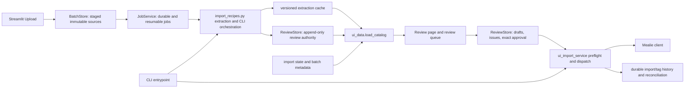

# Recipe-Importer Repository and User-Journey Audit

**Audit date:** 2026-10-24
**Repository:** `MayorofRapture/Recipe-Importer`
**Branch and baseline:** `feature/complete-recipe-workspace`, `aa22fa3318042a4f48811d51d8f00c6e19d47c5f`
**Scope:** Read-only review of repository behavior, user journeys, tests, and existing design/maintenance documents. This report is the only requested repository artifact.

## 1. Executive summary

The current development branch has a substantial local-first review and recovery workflow. Uploads are staged by content identity; jobs can resume; extraction candidates and review decisions are persisted; source omissions and extraction uncertainty can be reviewed; approval is tied to an exact revision; and import dispatch rechecks current approval and prior import state. The GUI and CLI share durable import protections. The main correctness boundaries are documented and covered by focused tests. This is a more mature workflow than the older October 14 UI audit describes.

Four actionable findings remain. Two are P1 workflow/accessibility gaps: whole-cookbook PDFs cannot be processed as explicit resumable page ranges, and screen-reader users cannot access recipe content from the source scan through its generic image alternative text. Two are P2: the success cue after saving a changed draft is lost when Streamlit reruns, and UI services depend on state primitives housed in the CLI orchestration module. No P0 finding was supported by the evidence reviewed.

The existing `docs/mealie-compatibility-and-large-pdf-capability.md` already documents the page-range limitation and a safe design. The existing `docs/maintenance-refactoring-roadmap.md` already identifies the CLI/UI module coupling. The new work is to prioritize those known gaps and make the draft-save feedback reliable; broad rewrites, removal of legacy compatibility, and dependency cleanup are not supported by this audit.

Local unit, browser, syntax, CLI, and synthetic benchmark checks were run. Browser runs used synthetic fixtures and simulated imports only. No live Gemini or Mealie service was contacted, the installed Mealie version remains unknown, and full keyboard/DOM accessibility conformance was not established.

## 2. Audit environment and evidence

### Repository and tools

- Audited branch: `feature/complete-recipe-workspace`.
- Baseline commit: `aa22fa3318042a4f48811d51d8f00c6e19d47c5f`; at audit start it matched `origin/feature/complete-recipe-workspace` and the head of open PR #3. PR #3 remained open and unmerged during inspection: <https://github.com/MayorofRapture/Recipe-Importer/pull/3>.
- Working tree at start contained unrelated untracked `.vscode/` and `graphify-out/`. They are preserved and excluded from the requested report commit.
- Read project guidance, README, environment template, architecture/UX/compatibility/maintenance documents, entrypoints, relevant implementation modules, test inventory, and applicable project-local skills. `.env`, source scans, and production state were not opened.
- Applied the project Ponytail audit/review/debt guidance, Recipe Review UX, product-design and accessibility checklists, import-safety, model-routing, extraction-quality, Streamlit, Playwright, and verification guidance. No `shortcut:` or legacy `ponytail:` debt markers were found in the source/docs scan.

### Graph evidence

The checked-in/local `graphify-out/GRAPH_REPORT.md` and `graph.json` identify commit `aa22fa33` and date 2026-10-24, matching the audited baseline. The report describes 1,975 nodes, 7,143 graph edges, 153 communities, no import cycles, and an 86% extracted / 14% inferred relationship split. The JSON contains 7,357 relationship records; this count differs from the report's edge summary, so the graph counts are treated as tool summaries, not project-quality metrics. The graph artifact version recorded in its cache path is 0.9.95. It was used to navigate likely ownership boundaries; every finding below was checked against source and tests. The Graphify package/CLI was unavailable in the active environment, so the graph was not regenerated. No semantic/external graph source was used.

### Local verification performed

- `.venv\Scripts\python.exe -m unittest discover -s tests -v` with temporary directories directed to `tests/.test-tmp`: completed with exit code 0. Per-case counts were not retained in this report; no live service access was configured for these tests.
- `.venv\Scripts\python.exe -m compileall -q -x '(^|[\\/])(\.git|\.venv|\.agents|\.test-tmp|output)([\\/]|$)' .`: exit code 0. It warned that several pre-existing temporary directories could not be listed due to Windows access denial; those temporary contents were not validated.
- CLI `--help` with dotenv loading disabled: exit code 0 and options rendered.
- JavaScript syntax checks for browser scripts and `node --test tests/browser_fixture_runner.test.mjs`: 9/9 passed.
- Synthetic Chromium workflow `tools/browser_review_acceptance.mjs`: passed proposal accept/edit/reject, critical issue retention, approval, section round trip, and simulated import assertions.
- Synthetic Chromium history/recovery workflow `tools/browser_history_recovery_acceptance.mjs`: passed historical disclosure, confirmation gating, and durable attempt/Mealie identity assertions.
- Synthetic upload/review workflow `tools/browser_upload_journey.mjs`: reached review and saved a draft, then timed out waiting for the visible “Draft saved (revision 1)” cue. The implementation calls `st.success` immediately before `st.rerun()` for a changed revision, so the cue is discarded on the rerun. This reproduces a feedback issue; it does not demonstrate lost draft data.
- Synthetic catalog benchmark, 1,000 candidates / 100 sources / 20 warm samples: cold load plus registration 4.044 s; warm p50 0.305 s, p95 0.350 s; externally appended approval visible after 0.312 s. This is one local synthetic run, not a production workload guarantee.

### Limits

The browser journeys used isolated fixture data, and fake service adapters; they do not establish behavior against a live server. No Gemini call, Mealie write, installed-Mealie contract check, full screen-reader test, keyboard-only conformance run, or automated contrast audit against the running UI was performed. Benchmark results are directional. The audit did not treat inferred graph links as evidence without source confirmation.

## 3. Architecture and ownership

`streamlit_app.py` mounts Upload, Review, and Import & history pages. `batch_store.py` owns content-addressed upload staging and input limits. `ui_job_service.py` persists/resumes extraction jobs and invokes local OCR or the shared extraction pipeline. `recipe_quality.py` holds candidate, batch, diagnostic, suggestion, and completeness models. `review_store.py` owns durable review history, identity reconciliation, revisions, issues, and exact approval projections. `ui_data.py` combines caches, registrations, source metadata, review decisions, and import state into the UI catalog. `app_pages/review.py` renders and edits review state. `ui_import_service.py` performs current-state preflight, intent recording, dispatch, and reconciliation; `mealie_client.py` is the service adapter.

`import_recipes.py` currently contains the CLI entrypoint and orchestration alongside reusable `StateStore`, digest, and identity primitives. UI catalog and import services import those primitives directly; the job service also imports CLI processing functions lazily. This is a real ownership coupling, already identified by the maintenance roadmap, but the import safety boundary is shared and tested. Refactor the boundary incrementally while preserving serialized identity and public CLI behavior.

## 4. User journey assessment

| Journey | Current behavior and evidence | Assessment |
|---|---|---|
| A. Configure and start | `.env.example` documents configuration; `streamlit_app.py` provides native pages; cloud job modes require explicit consent and runtime configuration. | Clear separation between local setup and cloud extraction. Live credentials/configuration were not exercised. |
| B. Upload source material | `BatchStore` validates type/signature, size, pages, deduplicates by source content, and stages immutable input. Files default to 50 MiB and PDFs to 100 pages. | Safe for recipe-sized sources. Whole-book PDFs/page selection are unsupported (AUD-001). |
| C. Extract and recover | `JobService` records per-source outcomes, can pause/resume, avoids relaunch while leased, and does not repeat successful sources on resume. Extraction batches and caches are versioned. | Good resumability boundary; live provider quotas and response behavior remain unverified. |
| D. Review against source | Review queue shows source preview, extraction details, diagnostics and proposals; structured edits use stable row IDs; proposal decisions are distinct and an unresolved critical issue blocks approval. | Strong review authority for sighted users. Generic image alt text prevents a screen-reader user from comparing source content (AUD-002). |
| E. Save and approve | Drafts and exact revisions persist; approval binds source/extraction/revision/content; stale or ambiguous identity requires review. Browser acceptance covers proposal and approval paths. | Authority is robust. The save success message disappears after a revision-changing rerun (AUD-003). |
| F. Import | `ui_import_service` re-reads review/import state, records intent and distinguishes definite rejection from uncertain outcomes. Existing imported candidates are protected against repeat create. | Good duplicate and ambiguity controls; external contract not live-verified. |
| G. History, tags, recovery | Import and tag outcomes are separately recorded; history can disclose prior outcomes; tag repair and uncertain-attempt reconciliation are explicit. Synthetic history/recovery browser acceptance passed. | Recoverable workflow, with live Mealie state and tag semantics still unverified. |

## 5. Prioritized findings

### AUD-001 — Whole-cookbook PDF input has no page-range workflow

- **Priority / confidence / category:** P1 / Confirmed / Missing functionality.
- **Location:** `batch_store.py:109, 299-300`; `docs/mealie-compatibility-and-large-pdf-capability.md` section F9.
- **Current behavior:** A file is staged as one immutable source. The default is 100 PDF pages and 50 MiB; PDFs over the page bound are rejected. Accepted PDFs are processed as whole documents, with no page-range identity in batch/job/cache state.
- **User scenario:** The intended workflow is importing a cookbook PDF. A book longer than the configured bound cannot be uploaded; increasing the bound alone would preserve whole-file extraction and leave page ownership, retry granularity, and duplicate titles across pages unresolved.
- **Evidence:** Direct code inspection and the existing F9 compatibility document, which records a synthetic 101-page rejection and explains that a single extraction lacks page-specific provenance. No external cookbook or production file was used.
- **Impact:** Users must split files outside the app; retries and source traceability then depend on manual artifacts. Same-titled recipes on different pages cannot be reconciled by source location.
- **Smallest safe correction:** Implement explicit page-range child sources tied to the original PDF hash and inclusive page bounds. Preserve the original; derive deterministic range IDs; carry page provenance through job, cache, candidate, and review records; resume per range. The existing F9 design gives an implementation boundary.
- **Consequences / tradeoffs:** Adds page selection and provenance to upload, job recovery, and review. It must retain compatibility with existing whole-file batch records and bound temporary PDF creation/memory.
- **Effort:** Large. **Change type:** Add.
- **Regression evidence to require:** Synthetic PDF above 100 pages; ranges with duplicate recipe titles; overlapping/multi-recipe ranges; interruption and resume; source bytes changing; bounded rendering; existing whole-file records still readable; original PDF unchanged.

### AUD-002 — Source scan alternative text does not expose recipe evidence

- **Priority / confidence / category:** P1 / Confirmed / Accessibility and review workflow.
- **Location:** `app_pages/review.py:1461-1470`, source preview and “Source and extraction details” expander.
- **Current behavior:** The image alternative is “Recipe source page N”. The adjacent details expose collection, extraction method, confidence, and uncertainty notes, but no source transcription/content.
- **User scenario:** A screen-reader user needs to compare ingredient quantities and instructions to the scan before approving. The image label identifies a page, but provides none of the recipe evidence required for that decision.
- **Evidence:** Direct source inspection; current rendered code. The browser runs did not claim screen-reader or DOM accessibility conformance.
- **Impact:** The source-verification task is unavailable or materially incomplete for users who cannot visually inspect the scan. The source is a core authority for approval, so this is more than decorative image description.
- **Smallest safe correction:** Provide a separately labeled, accessible source-text view when transcription is available, with its extraction provenance and uncertainty clearly exposed. Preserve the image and make clear that OCR text is a reading aid subject to comparison, not an approval or correction. If no usable transcription exists, expose that state and retain a path to request assistance rather than claiming verification.
- **Consequences / tradeoffs:** OCR may itself omit or misread source content; the view must not promote OCR or a model proposal into authoritative recipe fields. Validate navigation, labels, and source-text uncertainty with assistive technology.
- **Effort:** Medium to Large. **Change type:** Add.
- **Regression evidence to require:** Accessibility tree includes source text and provenance; screen-reader and keyboard pass through source and extracted fields; missing/OCR-error state is understandable; OCR suggestions remain distinct from approved recipe content; visual source preview remains available.

### AUD-003 — Draft-save success cue is discarded by rerun

- **Priority / confidence / category:** P2 / Confirmed / UX feedback.
- **Location:** `app_pages/review.py:495-505`; `app_pages/review.py:1600-1605`.
- **Current behavior:** `_save` calls `save_draft`, displays `st.success`, sets the active selection, and immediately calls `st.rerun()` when a new revision was created. The rerun clears the transient success message. `_render_actions` only shows persistent feedback if `review_save_state` is set; this path does not set it.
- **User scenario:** After editing a recipe and selecting Save draft, the user expects to know whether the draft was saved. The browser upload journey reached review, clicked Save draft, and timed out waiting for “Draft saved (revision 1)”.
- **Evidence:** Real Chromium run against an isolated synthetic fixture; direct code trace. Unit tests verify draft persistence/authority, so this finding concerns visible confirmation, not data loss.
- **Impact:** Users may repeat a save, hesitate before navigating, or mistake a successful durable save for a failure. This undermines confidence in a high-frequency action.
- **Smallest safe correction:** Store a candidate/revision-bound save status in session state before rerun and render it on the resulting view; clear or update it when the draft changes or a different recipe is selected.
- **Consequences / tradeoffs:** Status must be invalidated when stale so it cannot imply a later edit has been saved.
- **Effort:** Small. **Change type:** Fix.
- **Regression evidence to require:** Browser saves a changed draft, sees the revision confirmation after rerun, reloads and verifies the same revision is durable; later unsaved edit clears or changes the confirmation; failed save leaves text and shows the error.

### AUD-004 — UI services import shared state primitives from CLI orchestration

- **Priority / confidence / category:** P2 / Strong evidence / Simplification and change risk.
- **Location:** `ui_data.py:17`; `ui_import_service.py:13`; `ui_job_service.py:670-694`; definitions in `import_recipes.py:107,123,256,733`.
- **Current behavior:** Catalog and import service modules import `StateStore`, digest, and identity functions from `import_recipes.py`. The job service lazily imports processing and provider helpers from that same module. Thus importing/altering the CLI orchestration module is part of the UI runtime dependency path.
- **User scenario:** A CLI extraction/orchestration change may unintentionally affect UI startup, import state, or identity behavior; a developer must reason across the CLI and UI paths even for a small state primitive change.
- **Evidence:** Direct import and call-site inspection; the maintenance roadmap already documents this confirmed coupling. No current user-visible defect or import cycle was found.
- **Impact:** Raises change cost and regression risk and makes CLI module ownership less clear. The risk is architectural, not an observed production failure.
- **Smallest safe correction:** Move stable state, digest, and identity primitives into a focused shared module and re-export from `import_recipes.py` for compatibility. Move extraction orchestration only as separately justified; preserve IDs and ledger schemas.
- **Consequences / tradeoffs:** Requires compatibility coverage for CLI imports and serialized identity. A broad decomposition of `review_store.py` or `app_pages/review.py` is not warranted without smaller boundaries and tests.
- **Effort:** Medium. **Change type:** Simplify.
- **Regression evidence to require:** Existing state and identity fixtures retain identical results; import state and review ledgers remain byte/record compatible where promised; CLI help and extraction-only paths work; UI catalog and import tests run through the relocated primitives.

## 6. Unused or removable code

No safe deletion was established. The graph and broad module sizes are not evidence of dead code. `write_ui_fixture` is used by browser acceptance tooling; legacy review and compatibility paths are exercised by tests and preserve existing records; helpers imported from `import_recipes.py` are actively used by UI modules. The audit did not find a dependency that could be removed without a separate usage and environment check. Keep cleanup focused on the state-primitive boundary in AUD-004 rather than deleting legacy support or splitting large modules for appearance.

## 7. Missing functionality

The principal product capability gap is whole-cookbook page-range ingestion (AUD-001). Recipe-sized sources fit the current workflow, but books require external splitting and do not get app-level range provenance or resumability. The other missing capability is an accessible text route to the source evidence needed for approval (AUD-002). These are distinct changes: one expands source and recovery identity; the other expands access to evidence while preserving its uncertainty.

## 8. UX and workflow problems

The review flow keeps source, structured recipe, diagnostics, proposals, durable draft, approval, and import as distinct concepts. The simulated browser acceptance verified proposal decisions, critical blocker retention, approval, section round trip, simulated import, history disclosure, and confirmation gating. This is a strong base for repetitive review.

The draft-save confirmation is a concrete friction point: the success signal is emitted before a rerun and does not survive it (AUD-003). Source review also depends on visual access to the image; generic alt text does not convey its contents (AUD-002). Automated screenshots and browser assertions do not establish full keyboard order, screen-reader behavior, or WCAG conformance. Those checks remain outstanding before describing the UI as accessible.

## 9. Reconciliation with prior audits and roadmaps

| Prior item | Current status from this audit |
|---|---|
| `docs/UI_UX_Audit.md` A01-A03: exact revision authority, draft/proposal precedence, stable structured-row identity | Largely resolved in current projection/review code and associated tests; no repeat defect reproduced. |
| A04-A06: workspace layout, full UI journey, save/navigation feedback | Core upload-review-import journey exists and browser acceptance covers important paths. Save feedback remains incomplete (AUD-003); visual workflow does not establish assistive accessibility (AUD-002). |
| A07-A08: approval blockers and identity collisions | Current critical diagnostics, exact approval, and ambiguous identity holds are present and exercised by review/import tests. |
| A09: source alternative text | Partially improved to identify page number, but source content remains unavailable through the alternative text/details (AUD-002). |
| A10: malformed ledger/cache resilience | Current stores fail closed for malformed durable ledgers and catalog loading can use compatible prior cache/registration paths. The audit did not reproduce silent history loss; no new finding is filed. |
| A11: performance and repeated catalog work | Current caching/indexing work and synthetic benchmark reduce the historical concern. The local synthetic benchmark is not production evidence; no performance defect was demonstrated. |
| A12: warning/hash exposure | The current review surface is more focused; no high-severity information exposure was reproduced. Diagnostics still merit ordinary UX review. |
| `docs/maintenance-refactoring-roadmap.md` | Responsibility boundaries and refactor stages remain useful proposals. CLI/UI shared state coupling is still present (AUD-004); the roadmap correctly cautions against splitting durable review authority or compatibility paths without tests. |
| `docs/mealie-compatibility-and-large-pdf-capability.md` F8 | Mealie empty-instructions behavior remains blocked on exact installed version and authorized disposable live write. This audit did not alter that gate or call Mealie. |
| Same document F9 | Whole-book PDF page-range support remains unsupported and is confirmed by current upload limits (AUD-001). Existing deferred design remains the right starting point. |

## 10. Recommended implementation order

1. **Fix draft-save feedback (AUD-003).** Small, isolated change. Require persistent candidate/revision-bound confirmation, failure visibility, and browser reload evidence.
2. **Design and implement accessible source text (AUD-002).** Keep OCR provenance and uncertainty visible and separate from approved recipe values. Validate with screen-reader and keyboard evidence, plus an accessibility audit of the changed workflow.
3. **Implement page-range sources (AUD-001).** Treat as a bounded feature with explicit parent hash/range identity, immutable original, per-range cache and resume, duplicate-title reconciliation, and backward-compatible old batch records.
4. **Extract stable shared state primitives (AUD-004).** Do this when the adjacent ownership boundary is ready; retain CLI re-exports and prove ID/state compatibility before further orchestration moves.

### Acceptance and risk controls

- Every change must keep pending proposals out of import payloads and preserve exact-approval checks.
- Source/range identity must survive retries and must not rely on recipe array position or title alone.
- Never repeat create after an ambiguous Mealie outcome; preserve the existing reconciliation flow.
- Page-range work requires synthetic PDF tests and does not require raising global limits before range semantics exist.
- Accessibility work must expose OCR as uncertain evidence and cannot claim that a user verified the image solely by reading OCR.
- No live Gemini/Mealie validation is implied by local tests. Live verification remains separately gated by exact installed service configuration and authorization.

## 11. Deferred or rejected recommendations

- **Do not just raise the PDF page limit.** This does not add resumable page ownership or page provenance and increases work/memory bounds.
- **Do not merge proposal text into extracted recipe fields.** The source/review authority model correctly separates inferred content and pending suggestions.
- **Do not remove legacy review/state compatibility based on code size or graph output.** Existing tests and stored history make compatibility an active requirement.
- **Do not split every large module as a cleanup project.** Extract only stable boundaries with a regression test and unchanged serialized identity.
- **Do not treat the synthetic benchmark as a production performance guarantee.** No bottleneck requiring a broader optimization was established.
- **Do not claim live Mealie or Gemini compatibility.** The environment's exact Mealie release and real provider/service behavior were not verified.
- **Do not claim WCAG conformance from browser screenshots or fixture journeys.** Assistive technology and keyboard checks remain necessary.

## 12. Final recommendation

The repository is ready for narrow, well-bounded implementation work on the four findings. The most complex remaining workflow gap is page-range cookbook ingestion because it crosses source identity, staging, jobs, cache, review provenance, duplicate reconciliation, and recovery. The largest structural complexity is the shared CLI/UI state boundary through `import_recipes.py`; it is an incremental simplification opportunity, not a reason for a broad rewrite.

The top three user-facing actions are to preserve draft-save confirmation across reruns, give screen-reader users a source-text path with explicit OCR uncertainty, and implement page-range cookbook sources with durable provenance. No critical code defect was reproduced in the existing review/import safety boundary. The most important unverified integration risks are live Mealie response/tag behavior, Gemini quota behavior under real account traffic, whole-book source handling, and assistive accessibility. The offline suite, CLI/syntax checks, and fixture browser journeys provide meaningful development evidence, but they do not establish production-service compatibility.

**Final finding count:** 0 P0, 2 P1, 2 P2.
**Source-code, application, test, and configuration changes:** None requested or performed.
**External service calls:** None.
